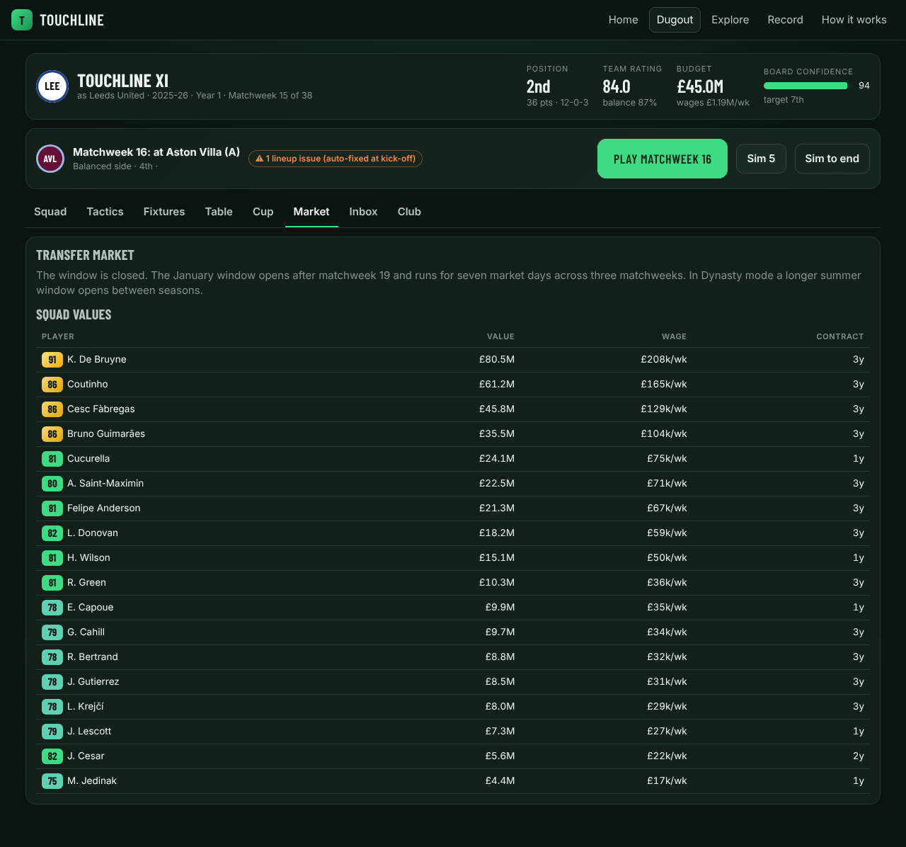

# Touchline

**Spin the wheel. Draft the XI. Manage the season.**

A free, open web football game that fuses the spin-and-draft loop of 38-0 with the week-by-week management of Football Manager. Spin a wheel that lands on a real club in a real season from England, Spain, Italy, Germany or France (2008-09 to 2026-27), draft one player from that squad, repeat until your side is built, then either simulate the season instantly or manage it one matchweek at a time: roles, instructions, condition, injuries, a cup, a January window, a board that counts. Your drafted side takes one real club's place in the league you choose and plays the other clubs' real squads of that season: 38 matchweeks in a 20-club league, 34 in an 18-club one.

No account, no server, no ads. Everything runs in the browser and saves to `localStorage`.

## Features

**Modes**

- **Quick Draft**: eleven spins, eleven picks, one click to simulate 38 matches. Five minutes and a shareable result.
- **Daily Challenge**: everyone gets the same wheel today (seed `daily-YYYY-MM-DD`). Streaks are tracked.
- **Season**: draft 16 to 22 players, then manage 38 matchweeks with three pre-season friendlies, a 16-team cup, a transfer window and a board.
- **Dynasty**: Season mode that never ends. Players age, contracts run down, some retire, you get summer bonus spins and the league moves on to the next real season.

**The draft**

- The wheel only lands on squads that can fill a slot you still need: no dead spins.
- A real player can be drafted once, whichever club or season you catch him in.
- Eight formations, position eligibility (a wing-back covers full-back, a wide midfielder covers the wing), era filters, one-club mode, hard mode (ratings hidden), re-spins and shareable seeds.
- Seven leagues: the Premier League, La Liga, Serie A, the Bundesliga, Ligue 1, the Eredivisie and the Primeira Liga, each with its own real clubs and seasons. Play in one league and draft from it alone, or switch on European Nights and draft from all seven.
- **Head-to-head**: two managers on one device draft from the same spins in snake order, then both sides play the same season, derbies included.
- Matches are played live in two halves: at the break you give a team talk, change instructions and make substitutions, and the AI reacts to the score too.

**Management**

- Thirty-four player roles and six team instructions whose effects are printed in every match report.
- An xG-based match engine with a live ticker, scorers, assists, cards, injuries, substitutions and player ratings.
- Condition, sharpness, familiarity, morale and form; suspensions at five yellow cards; injuries from a knock to a ruptured ACL.
- Weekly training focus, pre-match team talks, dressing-room events with choices, promises you can break.
- Have a word with any player once a week: praise, demand more, promise a start or reassure him. The reply depends on his form and his professionalism.
- A captain who matters: a leader with a strong mentality lifts the side in big matches and keeps low morale from sinking.
- Set-piece takers: name your penalty, free-kick and corner specialists and the engine uses them.
- Backroom staff: an assistant, a head coach, a physio and a chief scout in three tiers, paid from the wage cap, each with visible effects on familiarity, sharpness, injuries and the market.
- A cup played midweek after matchweeks 6, 14, 24 and 36, with penalties.
- **The Continental Cup**: tick it at setup and you join the fifteen strongest clubs from the other leagues that season in a second midweek knockout. In Dynasty a top-four finish qualifies you again.
- An active transfer market: a January window (and a summer one in Dynasty) with asking prices that move with form, age, rival suitors, bidding wars and deadline-day discounts; loans for fringe players; part-exchange deals; approach any player in the database and the club names a price; choose the contract length; AI clubs bid for your players and really sign the ones they buy; budget and wage cap.
- A shortlist: star players in Explore and approach them from the market in one click.
- In-season development: every five matchweeks young players who are playing grow and veterans fade, faster with a good coach; the dynasty summer does the big yearly step.
- Club legends: all-time appearances, goals, assists, man-of-the-match awards and titles for everyone who ever played for your side.
- Youth intake: every Dynasty pre-season the academy presents three real prospects aged 20 or under, preferably ones who actually came through at the club you replaced. Sign one for nothing or pass.
- Post-match press conferences: single out your star, credit the squad, take the blame or blame the referee, and answer the job question when the table turns.
- Man-mark the opponent's danger man from the opposition report: his influence drops, your attack loses a little, and the report tells you whether it worked.
- A depth chart of who can cover every position in your shape, rated there.
- Export and import your save file from the Record page, and a trophy cabinet across every game you have played.
- Installable as an app: a service worker caches the shell and any league pack you have opened, so the game starts and plays offline.
- Board target and confidence, with optional job security (you can be sacked).
- Awards, a team of the season, seventeen achievements, a local leaderboard and a share card for every season.
- Calibrated or Realistic difficulty.
- One saved game per mode: a quick draft never overwrites your dynasty.

**Explore**: browse every club-season in all seven leagues with its real squad and ratings, the highest-rated player-seasons by position, and a player search.

**Opposition reports** before every match, league-wide statistics (Golden Boot, assists, ratings, clean sheets) and an expanding deck of dressing-room events: contract renewals, wantaway stars, media pressure, rushed injury returns and derby bonuses.

## Screenshots

| The draft | The dugout |
| --- | --- |
|  |  |

| Season summary | Match report |
| --- | --- |
|  |  |



## Getting started

Requires Node 20 or later (Node 22.13 or later to rebuild the data).

```bash
git clone https://github.com/Minhhh13/Touchline.git
cd Touchline
npm install
npm run dev        # Vite dev server
npm test           # Vitest: engine, draft, match, season and data checks
npm run typecheck  # tsc -b --noEmit
npm run build      # tsc -b && vite build, output in dist/
npm run preview    # serve the production build
```

The player database ships in the repository (`public/data/<league>/` plus `public/data/leagues.json`): 69,118 player-seasons across seven leagues, about 1.0 to 1.3 MB per league, loaded on demand. To rebuild it from the public datasets (downloads several large archives on the first run, needs `unzip` and `node:sqlite`):

```bash
node scripts/import/build.mjs
```

See `docs/DATA.md` for sources, method, cache location (`.cache/datasets` or `DATA_CACHE`) and the nationality enrichment step.

## Project structure

```
index.html                 Entry page (fonts, favicon, meta)
src/
  main.tsx                 React root
  engine/                  Pure, deterministic game engine (no React, no DOM)
    rng.ts                 xoshiro128** PRNG, seeds, daily seed
    types.ts               Shared domain types
    positions.ts           Ten positions, attribute weights, position fit
    roles.ts               34 roles with weights, unit contributions, effects
    formations.ts          Eight formations with slot coordinates
    ratings.ts             Role ratings, live modifiers, team strength, chemistry, auto-pick
    tactics.ts             Team instructions, AI styles, tactical modifiers
    match.ts               The match engine (xG, Poisson goals, events, ratings)
    season.ts              Fixtures, table, cup, recovery, morale, board, tiers
    draft.ts               The wheel and draft rules
    market.ts              Transfer windows, pricing, bids, offers, finances
    events.ts              Dressing-room and media events
    training.ts            Weekly training focus
    awards.ts              Awards, achievements, share text
    universe.ts            Loads players.json and meta.json into typed structures
    __tests__/             Vitest suites
  game/
    store.ts               Zustand store with Immer, persisted to localStorage
    types.ts               Game, settings, profile types
    logic/                 setup, quick season, weekly loop, squad, market ops, dynasty
  ui/
    App.tsx                Shell and routing between screens
    screens/               Home, Setup, Draft, Dugout, MatchScreen, Summary, Explore, Profile, HowTo
    components/            Wheel, Pitch, PlayerRow, TableView, MatchTicker, bits
    styles.css             Theme tokens (dark "Floodlit" and light "Daylight")
scripts/import/            Data pipeline (build.mjs, download.mjs, parsers, club and nation tables)
public/data/england/       Generated players.json and meta.json
docs/                      RESEARCH.md, GAME_DESIGN.md, DATA.md
.github/workflows/ci.yml   Typecheck, test and build on Node 22
```

## Tech stack

- Vite 6, React 19, TypeScript 5.8 (strict).
- Zustand 5 with Immer for state, persisted to `localStorage` under `touchline-save-v1`.
- Vitest 3 for tests.
- No backend, no analytics, no external services at runtime; Google Fonts is the only third-party request.
- Path aliases `@engine`, `@game`, `@ui`.

## Data and credits

Ratings and squads are built from public datasets: Stefano Leone's EA Sports FC 24 complete player dataset (CC0), nyagami's FC 25 database (Apache 2.0), justdhia's FC 26 ratings (CC0), mikedpad's FC 27 ratings (unofficial non-commercial snapshot), Hugo Mathien's European Soccer Database (ODbL), openfootball/england results (public domain) and Wikidata (CC0). A player's rating for a season comes from the edition published after it, so it reflects how he actually played. Values and wages are our own model. Full detail, method and limits are in [docs/DATA.md](docs/DATA.md).

Design documents:

- [docs/RESEARCH.md](docs/RESEARCH.md): 38-0 and Football Manager analysis and the fusion thesis.
- [docs/GAME_DESIGN.md](docs/GAME_DESIGN.md): every system and formula as implemented.
- [docs/DATA.md](docs/DATA.md): data pipeline, sources and licences.

## Roadmap

- Seasons before 2008-09 (needs a ratings source for the 1990s and 2000s)
- Online leaderboards for the daily challenge
- More leagues (Portugal, the Netherlands) and a group stage for the Continental Cup
- Youth intake and player development targets in Dynasty


## Disclaimer

Touchline is an independent fan project. It is not affiliated with, endorsed by or sponsored by any league, club, governing body, game publisher or ratings provider. Club and player names are used descriptively; no official crests, logos, kits or likenesses are used. Player ratings are an independent interpretation derived from publicly available data and may differ from any official source. Datasets are credited to their authors and used under their published licences.
