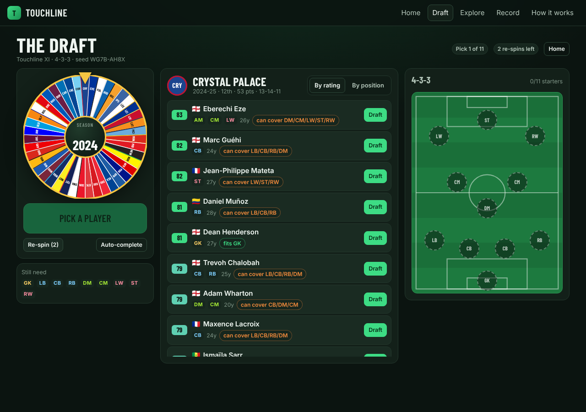
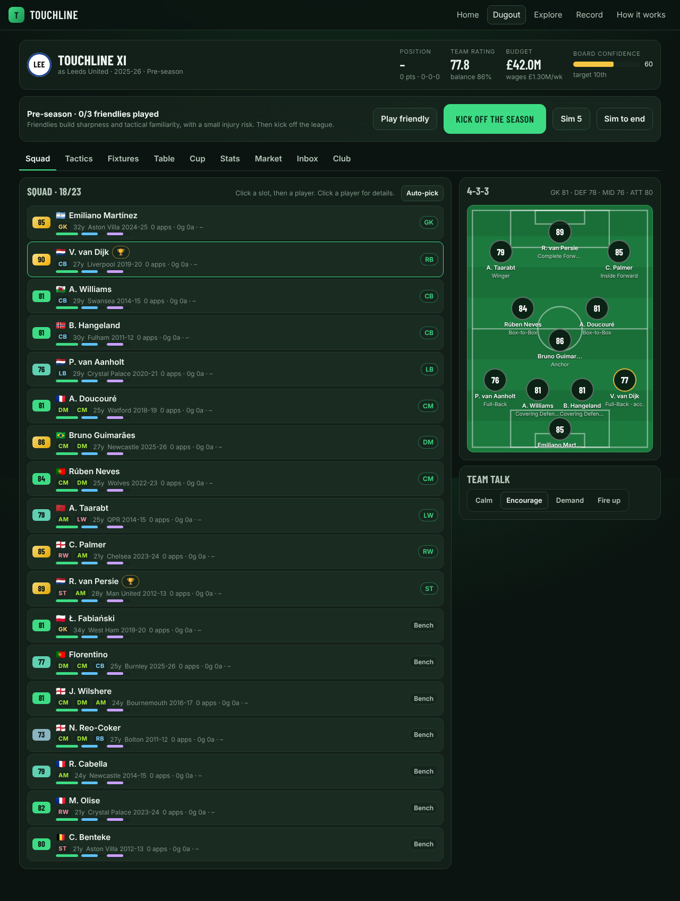
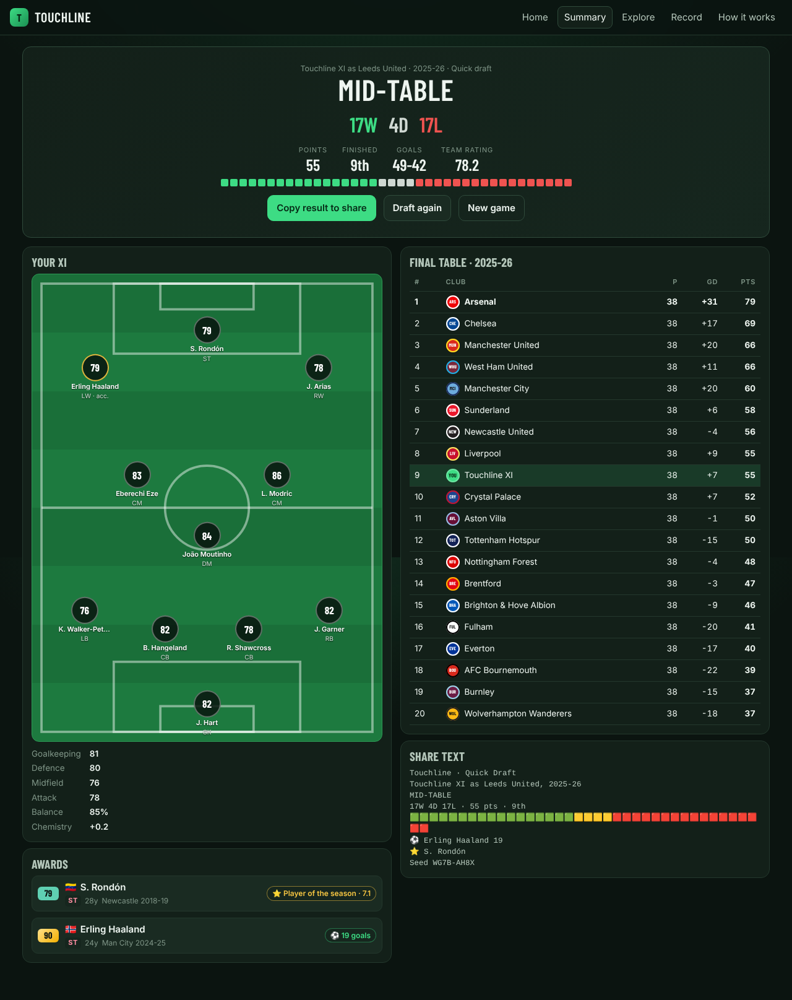
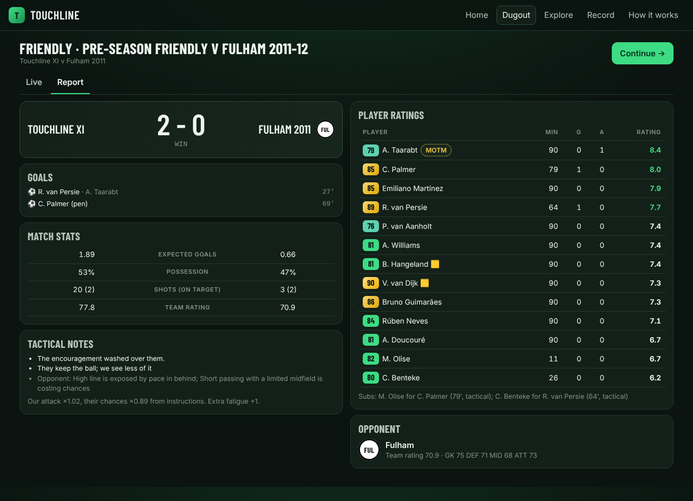
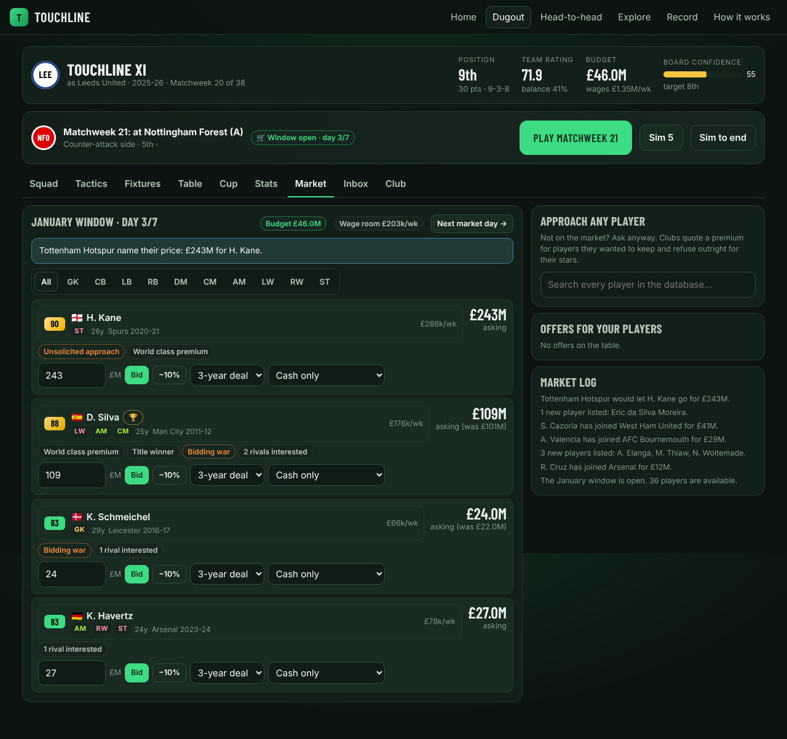
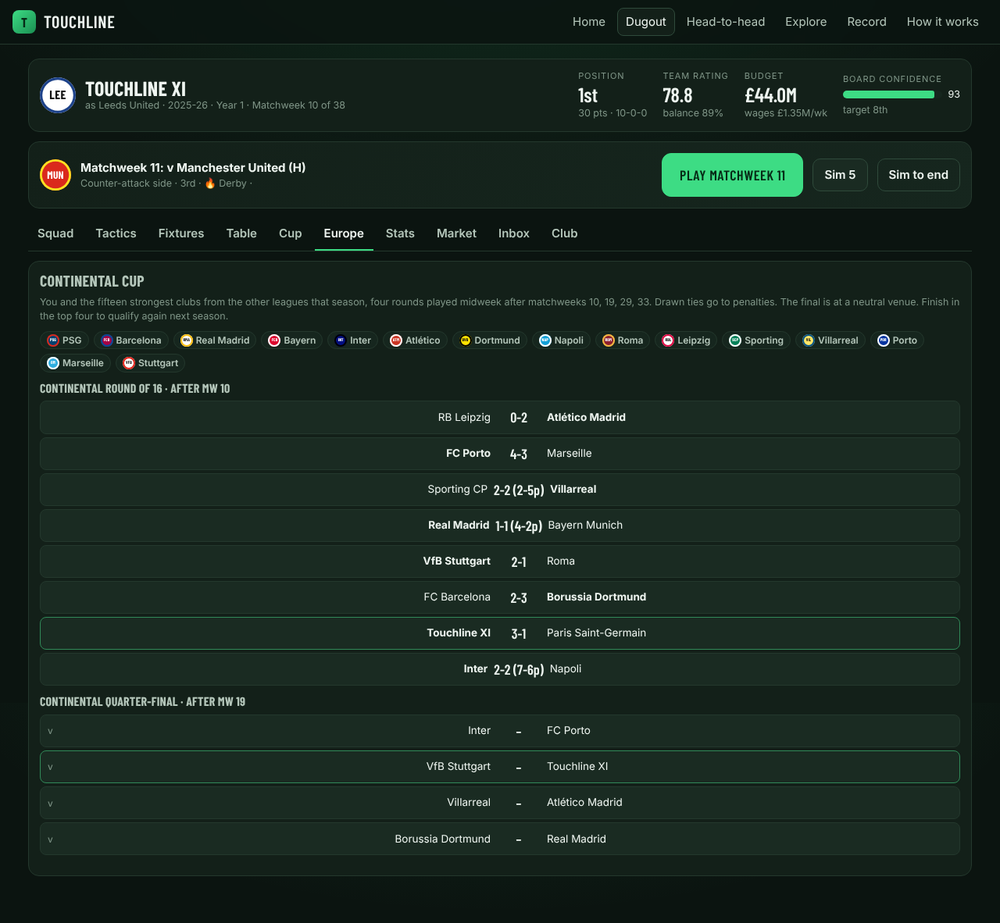
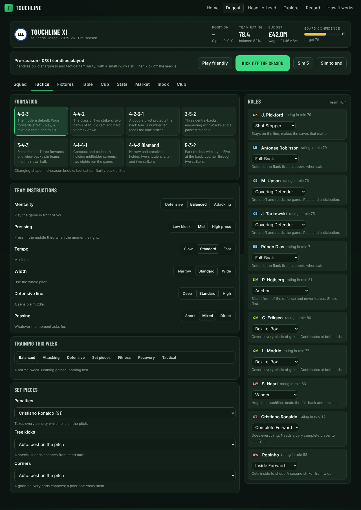
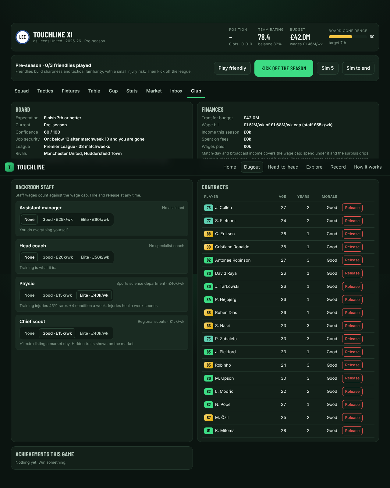
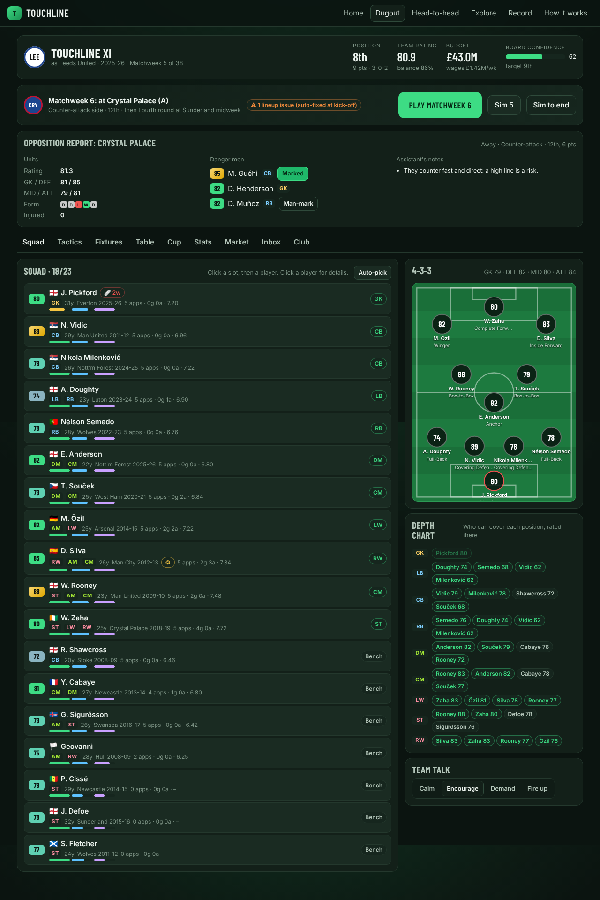

# TouchLine

**Spin the wheel. Draft the XI. Manage the season.**

A free, open web football game that fuses the spin-and-draft loop of 38-0 with the week-by-week management of Football Manager. Spin a wheel that lands on a real club in a real season from England, Spain, Italy, Germany or France (2008-09 to 2026-27), draft one player from that squad, repeat until your side is built, then either simulate the season instantly or manage it one matchweek at a time: roles, instructions, condition, injuries, a cup, a January window, a board that counts. Your drafted side takes one real club's place in the league you choose and plays the other clubs' real squads of that season: 38 matchweeks in a 20-club league, 34 in an 18-club one.

No account needed, no ads; optional sign-in syncs your games and posts verified Daily scores. Everything runs in the browser and saves to `localStorage`, and every mode works signed out and offline. The Privacy and fair play page (linked from Home, How it works and the sign-in panel) says what an online build stores, where, for how long and how to delete it.

## Features

**Modes**

- **Quick Draft**: eleven spins, eleven picks, then a "Squad complete" screen with the pundits' prediction (projected finish, expected points, the chance of the title, a top-four, top-six and top-ten finish and of going down, from 2,000 trial seasons) and the XI's Overall, Attack, Midfield, Defence and Goalkeeper bars, a big Simulate season button, and the tactics folded under it (mentality, tempo, pressing, defensive line, width, passing, captain and penalty taker; the odds follow them), and the season played back game by game: one game every 1.5 s (0.5x 3 s, 2x 750 ms, 4x 375 ms) each result dropping in at the top of the list (newest first, tinted green, amber or red with a W/D/L badge, the opponent with H or A, the score, your scorers with minutes and your position), a "Matchweek n / 38" header, Won/Drawn/Lost/Points boxes that count up as results land with GF, GA and GD, Pause, "Skip to January" and "Skip to the end". The whole season is simulated before the first game shows; only the reveal is paced. Five minutes and a shareable result.
- **The 38-0 chase**: the goal of a Quick Draft is to win every game. Setup and the kick-off screen say so, the "Pundits' prediction" (as the Squad complete odds panel is now called) gives the chance of a perfect and of an unbeaten season, the playback carries a "Still perfect: 12-0" badge that flashes red on the game that ends the run ("Perfect run over at 12-0", then "Unbeaten: 15"), the summary leads with the record against 38-0 ("31-4-3 against 38-0, 7 wins short"), the Profile keeps your best record, longest perfect run and perfect seasons, and the share text shows the record ("31-4-3 · 97 pts · 1st"). An elite XI goes 38-0 in about 1.3% of seasons.
- **A season you watch**: the playback plays a game every 1.5 s at 1x (0.5x, 2x and 4x too, remembered per browser) beside a live league table whose rows slide as places change (arrows, zone tints for the title, top 4, top 6 and the drop) and a chart of your league position by game with the leading rivals, with short moments for going top, reaching the top four and every fifth straight win, and the points gap to the top or the place above. On a desktop, Squad complete, the playback, January and the summary each fit one screen in boxed panels that scroll inside themselves; on a phone they stack and the playback's views are tabs. Quick seasons show only your team name, never "as" a club.
- **Pick a manager in Quick Draft** (Setup's Manager option on Pick; Spin, below, is the default; never on the Daily): once the draft is done, choose who picks the team from the real managers of the club-seasons you drafted (head coaches with their dates, from Wikidata), the club you took most players from first; when the record has nobody for your clubs, invented archetypes (The Press Conductor, The Showman, The Pragmatist, The Dead-Ball Coach, The Academy Builder, The Steady Hand) make up the list. Each manager has a style (pressing, attacking, defensive, set pieces, youth or balanced) worth at most 4% on expected goals at either end, a little more when the instructions suit it. He shows on the draft, the Squad complete screen (where you can change him), the season playback, the summary and the share text, and challenge links carry him. Off, the season is exactly the one the XI played before managers existed.
- **Spin your manager** (Setup's Manager option: Spin, the default, Pick or Off): once the XI is drafted three case reels spin at once, multi-case style, each landing on a real manager from the wheel's club-seasons in the rarity colour of the side he ran (the odds per reel shown); pick one of the three for the season. The same seed and draft land the same three, and challenge links replay them and the pick.
- **The end-of-draft case** (Setup's End case card, on by default; never the Daily or a challenge link's game): one case after every casual Quick Draft, odds on the screen (Common 54%: Peek, Swap, Lock; Rare 28%: Re-roll season, Captain's armband; Epic 13%: the Upgrader; Icon 5%). A power-up goes to your locker (Profile shows it) to unpack in a later Quick Draft played without the power-up tray; an Icon, an all-time great at his peak, can take a drafted starter's place in a slot he can cover, which marks the season non-standard (no points record, a ★ Case Icon chip on the board).
- **A bench in Quick Draft** (Setup's Bench option: Off or 1 to 5 places, 1 by default; never on the Daily): any pick can go to the bench instead of a slot while it has room, and once the XI is full you can spin for the bench or go straight to kick-off with eleven. In the season you have three changes for the whole campaign: pause the playback, tap a bench player and the starter he replaces (in a slot he can play), and the change sticks from the next game until you change it again. An injured starter misses the games his injury costs and is covered automatically by the best fit on the bench who can play there, which uses none of the three. The playback shows the XI for the next game on a pitch, the bench with who is injured and the changes left; the summary and the share text list the changes, and challenge links carry them so the season still verifies. With nobody brought on and no injury covered, the season is exactly the one the XI would have played without a bench: bench spins draw from their own stream.
- **January window** (Quick Draft and the Daily, on by default, a toggle under Advanced; the Daily always has it): after matchweek 19 of 38 the playback stops on a "Halfway there" panel (W-D-L, points and goal difference, one line on the pace, "Enter the transfer market" or "Stick with your XI"); the market has a budget (8% of your XI's value for the leaders rising to 20% for the bottom side, at least £5M), three to five offers for your three weakest slots (signings for a fee, the last one a straight swap) and one deal or a pass, with no undo; the tactics can change there too and the second half plays on from the same seeded stream. Passing gives exactly the season you would have had without a window. The summary and the share text name the deal ("January: signed Rice (£45M), Fernandes out"). In a Quick Draft the window is a gamble, four boxes on one panel: the **January spin** (a case reel with the exact odds of each rarity tier, gold 3%, red 9%, pink 20%, purple 30%, blue 38%, landing on a player of your wheel who can cover a slot; bring him in for whoever you choose or keep your XI), the **January Upgrader** (one roll on one of your XI for the second half, the Gamble mode Upgrader's dial and odds), the transfer market as above, or Skip. The Daily and the weekly keep the plain window, and a season with the spin or the Upgrader never ranks on their boards.
- **Cup nights after the league** (Quick Draft): once the season is over, play the Cup (sixteen of the league's clubs, one-off ties, extra time and penalties when level, a final at a neutral ground) and, after a top-seven finish, the Continental Cup against the strongest sides of the other leagues that season, each revealed tie by tie with the newest at the top, or skip either. Trophies show on the summary, in the share text ("🏆 Cup winners", "🌍 Continental Cup: semi-finals"), in the trophy cabinet and in challenge links; the league result never changes.
- **The Super League** (Quick Draft, one more card in Setup's step 3, League and season, a "Super League" chip after the league flags: "The 19 greatest sides in the data"): instead of a real league season your XI plays a 38-game double round-robin against the nineteen greatest club-seasons across all seven leagues, one season per club and each club at its best, ranked by the engine's own team strength (each real squad's auto-picked best XI) and played at full strength, whatever the Opposition setting. With today's data: Real Madrid 2017-18, Liverpool 2019-20, Manchester City 2023-24, Bayern Munich 2016-17, Paris Saint-Germain 2025-26, FC Barcelona 2018-19, Juventus 2017-18, Arsenal 2026-27, Inter 2008-09, Manchester United 2008-09, Chelsea 2008-09, Atlético Madrid 2018-19, Tottenham Hotspur 2017-18, Borussia Dortmund 2025-26, AC Milan 2023-24, Napoli 2022-23, Aston Villa 2025-26, Roma 2017-18 and Bayer Leverkusen 2024-25; classic seasons count only with the Classic toggle (none of them makes the nineteen today). The wheel draws from every league; the pundits, the playback's live table and chart (each side named with its season, "Barcelona 2018-19", with its badge), January (offers from every league), the 38-0 chase and the summary ("Super League champions") all follow it. There is no domestic cup; a top-seven finish earns the Continental Cup against the next fifteen greatest clubs. The field is the same for everyone (no seed), challenge links carry the rule, and no other game changes. An elite XI that goes 38-0 in a few Premier League seasons in a hundred went 0 for 1,000 here (champions in a third).
- **Every game, game by game**: the summary of a quick draft or the Daily lists all 38 games, newest first (or from matchweek 1 with a switch), with the opponent, the score, your scorers and their minutes ("Haaland 12', 67'", an opponent's own goal as "OG") and your league position after each matchweek. "Play the season" replays it one game every 220 ms with a running P W D L GF GA strip, and the result banner only lands after the last game, in short plain words (Perfect season, Invincibles, Champions, Title race, Top 4, Top 6, Mid-table, Relegation battle, Relegated) with a short line under it; the share text names your best win. The head-to-head result shows the same list for both managers.
- **Highlights of any game**: every game in the quick season's list, during the playback and on the summary, has a ▶ Highlights button that replays its key moments (goals, big chances, saves, cards) on the live pitch with the scoreline and a line of commentary each, with Pause, Next moment, Skip to full time and Close (a bottom sheet on a phone). The game is rebuilt from the season's seed, so the score is always the one in the list; nothing extra is saved but the season's start state.
- **Season Story**: every finished league season (Quick, Daily, Season, Dynasty) gets the one line that tells it ("🏆 Title sealed at MW 34 with 4 to play", "⬇️ Down at MW 35", "💔 12-0 until MW 13: 1-1 v Everton", "📈 9-match winning run (MW 14-22)"), a strip of every result in order, the runs, clean sheets and the best and worst results, and how the real club did that season ("📊 The real Burnley finished 19th on 22 · you 1st on 93"). The moment and the verdict go into the share text and onto the share card; the Profile page keeps the moment under each best season.
- **Daily Challenge**: everyone gets the same wheel today (seed `daily-YYYY-MM-DD`). Streaks are tracked.
- **Daily Arena**: one arena puzzle a day for everyone (seed `arena-YYYY-MM-DD`, UTC): the Gauntlet and the Cup of sixteen in turn, on the Premier League wheel, with the same ladder or draw for everyone and its own streak. One tap from the casual row on Home.
- **Weekly Challenge**: one themed quick-draft wheel per ISO week (seed `weekly-YYYY-Www`), across all seven leagues: a teammate chain, European Nights, the early years, a Moneyball cap, hard mode, one nation, the modern game, park the bus or Realistic, one a week in turn. The same league season, club and shape for everyone, its own streak, ends on Sunday.
- **A 38-0 setup in numbered steps, on one screen**: two boxes, as 38-0 reads. Left: 1 Pick your formation (every tile a mini pitch with the eleven positions as dots, beside the chosen shape drawn on a pitch), 2 Name your team (Clear and a Randomise dice: invented names only, never the seed), 3 Choose your league (flags). Right: 4 Set the rules (the Modes row and Power-ups for Quick Draft, Difficulty Easy 3 re-spins, Normal 1, Hard none with ratings hidden; Show ratings; Squad First or Position First; Season or Prime ratings; the bench; an Era panel with preset chips, a two-handle season slider and an "N of M seasons" count; an Advanced fold, More options for a season, with European Nights, twists, the January window, the Continental Cup, the seed, the season, the club you replace in a Season or Dynasty, the opposition and one-club or one-nation mode), 5 Spin (one line stating every choice, and Start). On a desktop it fits the window with no page scroll; on a phone the steps stack and Spin is a fixed bottom bar. A quick draft never names the club it replaces; Season and Dynasty say "You replace: <club>". The Home card and its button both open today's Daily setup.
- **Coach marks and the Key**: seven short callouts appear inline the first time you meet the draft reveal, the bench picks, the Squad and Tactics tabs, half time, the match report and the market, each gone for good after Got it (Show tips again on the Profile page brings them back). A Key chip on the Squad panel labels the condition and sharpness bars and the morale face and adds a legend under the pitch for the disc rating and its natural, acc. and awk. rings, remembered per browser.
- **Season**: draft 16 to 22 players, then manage 38 matchweeks with three pre-season friendlies, a 16-team cup, a transfer window and a board.
- **Season Highlights**: "Sim to the next big match" lets the assistant play the routine weeks and stops before every derby, title decider, cup semi-final and final, the last five weeks while the title or survival is still open, the January window and a board on the brink, so a season takes 15 minutes instead of 45. The button names what it can see coming ("Sim to Derby day (MW 12)") and the Dugout says why it stopped.
- **Run-in**: take over a real club at matchweek 28 (25 in an 18-club league) with its real squad, the table projected from the real final one (labelled as a projection everywhere) and a brief: win the title, reach the top four or stay up. Jobs come from every real title race, chase for Europe and relegation fight in the Premier League, La Liga, Serie A and the Bundesliga (28, 71 and 105 of them); the seed suggests three, or browse them all by season. Four spins of the wheel strengthen the squad, then the last ten games are played with Sim to the next big match, Realistic, and a board that can sack you from the first week. It ends in a verdict against what really happened ("You kept West Ham up on 41; the real West Ham went down on 39"), a share text, the Profile page's Run-ins table and its own shelf in the cabinet, never the league titles.
- **Arena: The Cup**: draft sixteen, then a knockout of 8, 16 (the default) or 32 real club-seasons in one sitting, or a one-off final. Pick the field: the wheel (one season per club), the champions of the data, the giants (the strongest 5% of every club-season), a decade (its sides of 78 or more), or this season's Europe (the top four of every league's latest complete season, loading all seven). The strongest quarter are seeded and kept apart in round one, each round is redrawn, the home side is a coin and the final is on neutral ground. Four days between ties: 60% of a week's recovery, a training focus each round, injuries count down and a red card or a second booking is a one-tie ban, for the AI sides too. Manage a tie through half time, the 70th minute and a shoot-out with your own penalty order and keeper, "Sim this tie", or Sim to the end; the ties between AI sides are played around yours, and once you are out the rest of the bracket plays on to its winner. Everyone on a seed gets the same field and first-round draw. Calibrated brings the field's average to a target (the assistant lifts a 16-club wheel Cup about one time in five), Realistic leaves every side at full strength. A bracket on the hub and the summary, a share text written tie by tie, Best runs and the cabinet's arena cups by size. The one-off final keeps the giants as its default opponent: managed through the two stops and a shoot-out where composure counts on kicks four and five.
- **Arena: The Gauntlet**: draft fourteen, then climb a ladder of fifteen real club-seasons from the wheel, each from a stronger slice of it than the last, away and at home in turn, until the first defeat (a level match goes to penalties). One lifeline changes a rung's draw, surviving rungs 2, 4, 6 and 8 earns a bonus spin for the bench (up to eighteen), and tired legs force rotation. Manage each rung through the two stops, let the assistant play it, or Sim to the end. The share text is the rungs climbed and a strip of squares; everyone on a seed climbs the same ladder. Calibrated caps each rung a little higher than the last (the assistant climbs about five), Realistic leaves every side at full strength.
- **Dynasty**: Season mode that never ends. Players age, contracts run down, some retire, you get summer bonus spins and the league moves on to the next real season.

**The draft**

- The wheel only lands on squads that can fill a slot you still need: no dead spins.
- A real player can be drafted once, whichever club or season you catch him in.
- Eight formations, each tile drawn as a mini pitch with the eleven positions in that shape (goalkeeper gold, defenders blue, midfielders white, forwards orange) wherever a shape is picked: Quick Draft, Season and Dynasty setup, Head-to-head and the Tactics tab. Position eligibility (a wing-back covers full-back, a wide midfielder covers the wing), era filters, one-club mode, re-spins and shareable seeds.
- **38-0 rules** (Position First on the Draft screen: tap a slot, the button reads "Spin for CB", and the list lights up who fits): a difficulty (Easy 3 re-spins, Normal 1, Hard none with ratings hidden), a ratings toggle for blind drafting (ratings hidden while you choose, then shown once a player is in your squad, with a small flip as he lands), Squad First (spin, then pick anyone and choose his slot) or Position First (choose a slot, then spin: the wheel only stops on a club with someone who can play there, and a re-spin keeps the slot), Season ratings or Prime (every player at his career-best rating across the wheel's leagues, the same on every device), and era presets All-time, 2000s+, 2010s+ and Modern (2016+) with a custom range and an "N of M seasons" count. Quick Draft defaults to Normal, Squad First, Season ratings; the Daily pins all of it so everyone plays the same wheel, and the share text names whatever differs.
- **One-Nation Draft**: pick a nationality at setup and every pick, signing and academy prospect must share it. Only nations with twice the cover for every position in your shape are offered (71 of the 161 known nations in the data for a 4-3-3 across all seven leagues, 26 from England alone); the wheel never lands on a squad without an eligible player, approaches for anyone else are refused by the board, and a wheel that runs dry lets you start with the eleven you have. Win the league for the International achievement.
- **Quick Draft modes**: a Modes row of icon cards to mix and match. Crazy (a twist on every spin, a random formation, surprise free re-spins, golden spins and forced positions), Hard (the Hard difficulty, linked both ways), Underdog (only bottom-half sides), Legends (only club-seasons with an 85+ player) and Speedrun (20 seconds a pick, then the assistant picks). Shown in the draft header, the summary and the share text, and carried in challenge links. The Daily keeps its original rules: 2 re-spins, twists on, season ratings, Squad First, no modes.
- **Classic seasons (1992-93 to 2007-08)**: the Premier League's sixteen seasons before the EA data, with their real squads and real tables (8,903 player-seasons, from Wikipedia and Wikidata facts) and TouchLine's estimated ratings. Opt-in: tick "Classic 1992-93 to 2007-08" under the Era slider in Setup (the slider then reaches back to 1992-93 and can widen the range into the later seasons), or play a classic league season; Prime ratings and the January window count classic seasons only for a game that opted in; the Daily, old challenge links and saves are untouched. Every estimated season carries an "Estimated ratings" mark in Explore, the Draft and the share text and card.
- **Wheel twists**: every third spin of a quick draft or the Daily is a twist spin. Golden: the wheel only stops on champions. Basement: only the bottom three of their league that season. Blind: ratings hidden until you have picked. Decade: the wheel stays in the decade of your last pick. The wheel decides which, never offers a twist its pool cannot serve (leagues without tables get only blind and decade spins), and a toggle at setup turns twists on for a Season or off for a quick draft.
- **The case reel**: every spin opens like a Counter-Strike case, season first. A drum stops on the drawn season (2017-18), then a strip of every club in that season's league slides under the marker and lands on the drawn club; the clubs the wheel could actually stop on are lit and the rest greyed out, so a golden spin runs through the whole league with only the champion lit. Every club-season carries a rarity colour from its squad strength (gold for the top 5% of its league's history, then red, pink, purple and blue), shown on the card, in the squad header and in the draft log. It runs at a case opening's pace: a very fast start, a long crawl over the last few cards, a small overshoot and ease back onto a random point inside the card, a beat at rest, then the reveal (about 7 seconds); re-spins run quick, Reel speed: Quick in Profile makes every spin about 2.7 seconds, Auto-complete skips the reel, and tap, Space or Enter skips to the landing. With reduced motion the result shows within a second. It sounds like one too: ticks as each card crosses the marker (fast, then slowing with the strip), a whoosh and pop as the season shows, and a reveal that grows with the rarity (a chime for blue up to a shimmer and sting for gold), all synthesised in the browser with no audio files. The speaker beside the reel, or Sound in Profile, mutes it on that device.
- **Spin odds and Gamble mode**: before every spin, in every mode, a panel under the reel shows the exact chance of landing in each rarity tier, from the wheel's real pool and weights. Gamble 🎲 (a Quick Draft mode) adds a 1% Icons spin, once per draft: the reel lands on a gold-star Icons card and you pick from the 60 best players of all time on the wheel, each at his peak. The Player Upgrader ⬆️ (with Gamble, or as a power-up on its own): once per draft, gamble +2, +5 or +10 on a drafted player at the exact odds shown on a dial (worse for a bigger boost and a better player); win and he goes up by the boost, lose and he drops by half. In-game only: nothing to buy. Both replay in challenge links.
- **Power-ups**: a Power-ups 🧰 toggle on the Quick Draft setup (never the Daily) puts a tray of six one-use power-ups on the draft screen, each with an Info tip: the Upgrader ⬆️, Re-roll season 🔁 (keep the club, spin only the year, odds shown first), Peek 👁️ (see the next spin's season), Swap 🔀 (move a starter to another slot he can cover), Captain's armband ©️ (+2 for the season) and Lock 🔒 (an Upgrader loss on him costs nothing). Every use shows in the draft log and the share text and travels in challenge links. In-game only: no money, nothing to buy.
- **Ghost drafts**: after any quick draft, "Challenge a friend" copies a link (`#c=...`, about 600 characters for eleven picks) that carries the seed, the shape, the league, the host club, the rules, every spin's pick and your result. Whoever opens it drafts the same wheel with your pick shown on every spin ("Last time here: K. De Bruyne"), plays the same season and gets a head-to-head summary with both XIs and a verdict line in the share text. The link is replayed pick by pick on arrival, so a claim is marked verified, could not be verified, or unverified when it was built on other data or another engine version; "Run it back" sets your own result as the ghost, and the Profile page marks the best run on each wheel. Tactics changed at kick-off or in January and the January deal travel in the link too, so a tweaked season still verifies. Links carry a version, so a link from a newer build says so instead of reading as broken. Arena runs travel too: a Gauntlet or Cup link gives your friend the same ladder or draw with your score on every step ("👻 Minh here: 2-1"), a verdict line ("⚔️ Climbed 9 rungs; Minh fell at rung 6"), and a claim verified by replay when the assistant played every match; a run you managed by hand is marked as your word, never as verified. Best runs shows "vs Minh" and can group runs by ladder.
- **Moneyball wheel**: switch on the Moneyball card in Setup's Modes row (or set a cap under Advanced or More options) (Shoestring £120M, Moneyball £180M, Big Spender £250M or your own, scaled up for bigger squads) and every player carries a price by rating and position, never age. Stars and scrubs, or spread it: the wheel only offers what you can still afford, keeps £0.5M back for every pick still to make so it never runs dry, and the result brags in money (`💰 £178M of a £180M cap · 0.52 pts per £M`). It works in Quick Draft, Season, a Dynasty's first draft and the arena (not with one club or one nation, whose pools are too thin); the Profile page sorts the Best on a budget, and a title on £150M or less earns Bargain Hunters.
- **Teammate Chain**: switch on the Teammate chain card in Setup's Modes row (More options for a season) and every club the wheel lands on holds a former teammate of your last pick, and you must draft one of them: the XI is one unbroken dressing room, every link named in the draft log ("Kroos → Modrić, Real Madrid 2017-18"). When nobody on the wheel ever played beside your last pick the chain breaks, that spin is free and the chain starts again. The share text says `🔗 Teammate chain · 11 links` (or how often it broke), the card prints the chain of club codes, and a title with an unbroken chain earns Dressing Room.
- Seven leagues: the Premier League, La Liga, Serie A, the Bundesliga, Ligue 1, the Eredivisie and the Primeira Liga, each with its own real clubs and seasons. Play in one league and draft from it alone, or switch on European Nights and draft from all seven.
- **Drawn flags**: every nationality and league shows an SVG flag (from flag-icons, MIT; see [docs/CREDITS.md](docs/CREDITS.md)) rather than an emoji, so flags render on Windows too instead of letter pairs.
- Seeds are honest across leagues: a European Nights seed lands on the same clubs whichever order the league packs were opened, and every loaded universe carries the data stamp of its packs beside an engine version, so a result can be checked against the data and engine that produced it.
- **Head-to-head**: two managers on one device draft from the same spins in snake order, then both sides play the same season, derbies included.
- Matches are played live with two stops: at half time you give a team talk, change instructions and make up to three substitutions; at the 70th minute you get the rest of your five changes, the instructions again and a touchline shout, and the AI reacts to the score at both stops.
- **Match visuals**: a live 2D pitch at the centre of the match-day dashboard (lying down on a desktop, standing up on a phone) with both XIs placed by formation slot and shifted by the instructions (a high line lifts the back four, width spreads the wide men, mentality moves the block), in the clubs' colours. A real football (a shaded white ball with black pentagon patches that roll the way it travels, a ground shadow, and long balls, crosses, clearances and shots lifted into an arc) is carried and passed between team-mates in spells of possession that follow the momentum, along hops timed by their length, with its speed carried through each touch so it never stops dead; it builds towards the box before every chance and goal, is struck from where the engine says the shot was taken (the shooter runs onto it) and sends the keeper diving on a save. Every dot eases to where it should be, so a turnover, a kick-off, a substitution or a skip never makes anyone jump; cards, injuries and substitutions are marked on the dot. 1x is a broadcast pace you can follow (a match minute takes 3 s, a pass a second or so); 0.5x, 2x, 3x and 4x are on the top bar and the speed is remembered per browser. It follows the clock's pause (freezing mid-pass) and stands still with prefers-reduced-motion. Under it a momentum strip and beside it the xG graph story fill with the clock; the report adds both, a shot map, possession and territory, each side's shape with its role labels and instruction arrows, rating bars for both sides and a downloadable match card with the score, the shot map and the xG story.
- **A goal you can feel**: the clock holds for about 2.8 seconds while the ball flies into the net, the net bulges, the pitch flashes and shakes, a GOAL! banner with the scorer, the minute and the new score bursts out over the pitch in the scoring club's colours with confetti, the scorer runs off to celebrate with his team-mates around him and the scoreboard lights up; then play restarts with a kick-off. A goal against you is short and subdued (1.7 s, a dimmer banner, no confetti), penalties and own goals are named as such, and with prefers-reduced-motion it is a still banner for 1.5 s. The score, the panels and the commentary change when the ball crosses the line, not before.
- **Watch, Auto-play or Sim result**: the Dugout remembers how you want to play the next match (saved with the game; old saves read as Watch). Watch stops at half time and at 70 minutes and opens your calls as a pop-up centred over the dashboard (phone included; minimised to a Decisions pill with Escape) with Play on, No changes, Let the assistant decide, Finish the match and Full sim; Auto-play watches the whole match with the assistant making both calls; Sim result goes straight to the report. While watching, Auto from here and Sim result on the top bar hand the rest of the match to the assistant. The assistant's calls are a pure function of the score, morale and tired legs, made through the same path as yours, so Sim result and Auto-play give the same result for a save and "No changes" plays exactly as before. Cup and European ties follow the same setting.
- **Match day dashboard**: the live match in the style of Football Manager's match screen, and everything on it moves with the clock. A top bar with the scoreboard (club codes on club colours, the clock, the added time once the board is up) and playback; both XIs in formation on pitches standing up, each man a shirt in club colours with his number, live rating, role code and surname, card marks and a sub arrow; three switchable widgets over the live pitch (heat map, match events and the xG graph story by default; also commentary, average positions, pass maps, action zones, shot map, match momentum, match stats, latest scores, live table, dugout and matchday info, each remembered per browser), both sides' stats beside the pitch filling minute by minute (shots, on target, xG, distance, pass completion, corners, tackles, fouls, bookings, possession), the momentum strip, a commentary banner and our XI along the bottom with position codes, condition and ratings. The live table and the round's other scores move as the goals go in elsewhere. The live pitch plays like a console match at 1x (4.5 s a match minute): sides build from the back, progress through midfield, switch the play, go wide or in behind and cross; the shapes climb and drop with the ball, the nearest men press, a side keeps the ball for spells and loses it to tackles and interceptions; corners, free kicks (one for every booking), penalties, goal kicks and throw-ins are set up before they are taken; and every shot comes at the end of an attack that fits its event (a corner for a header from a corner, a ball over the top for a man who rounds the keeper), the goal's last pass from its assister. A caption names the phase, and the commentary, stats and charts wait for each chance and booking to happen on the pitch. The half-time and 70th-minute decisions open as a pop-up over the board, which on a desktop (1280 by 720 and up) fits the window with no page scroll, the pitch sized by the height left; the last twenty minutes play live to the whistle, the report's shots, xG and possession are the dashboard's own numbers, and the Live tab replays a finished match on the same dashboard.
- **Match day controls**: the top bar works as Football Manager's does. Tactics shows the shape and roles; Instructions (tempo, width, passing in possession; pressing and the line out of it), the Mentality dropdown, Shouts (from the 70th minute) and Tweaks (penalty, free-kick and corner takers among the men on the pitch) change the match at the minute on the clock, and a chip says where a change lands: now, at the break, waiting for the next stop on an older save, too late in stoppage time, or a replay. Opening a drawer pauses the clock and closing it resumes. The squad strip's cards carry the position code, shirt and number, surname, a condition heart, the live rating, a morale face, cards and a sub arrow with the minute; its Squad control counts subs (n/5) and stoppages (m/3) and opens the substitution board: our XI on a small pitch and the bench as cards; drag a substitute onto a starter (mouse, pen or finger), or tap one and then the other, or use the keyboard, and every slot glows green, amber or red for how the held man fits it, with his role rating there; staged changes list with Undo, the team rating previews them, and Make changes makes them in one stoppage (half time spends none).
- **Match day on phones and tablets**: under 1200 px the pitch comes first (standing up on a phone, lying down on a tablet), then the commentary banner, an always-on momentum and xG row, a tab strip with every panel (remembered per browser; a tablet shows two side by side) and our XI as a sideways scroller. Drawers become bottom sheets, and the page never scrolls sideways.
- **Changes with the ball in play**: the engine decides each segment ahead of the clock and, when the manager changes something at minute k (instructions, set-piece takers, up to five substitutions in three windows with half time free, a shout from 70), rolls the segment back to k and replays the rest from a forked stream, so everything already shown stands and an untouched match is identical to a simmed one. The last twenty minutes can be held open to the whistle. Behind the match-day views: shots, on target and xG from the engine's own shot positions (calibrated to its conversion), possession and territory from the momentum, passes, tackles, fouls, corners, offsides and distance modelled minute by minute, live ratings and condition, the round's other scores and the live table revealed at your clock, heat maps, pass networks, action zones, commentary and classic shirt numbers.
- **The 70th-minute window with touchline shouts**: the match runs 1-45, 46-70 and 71-90, each segment taking its share of the expected goals by length (second half weighted 1.06 to 0.94, so 0.47, 0.294 and 0.236 of the match) and of the cards and injuries. All-out attack multiplies your chances by 1.3 and theirs by 1.35 and adds fatigue; shut up shop is ×0.55 and ×0.72; keep shape costs nothing. A side trailing at 70 goes attacking and fast, a side one up goes defensive and deep. Routine substitutions due after 70 wait for the window, and your own changes there override them. A simmed week and a hand-played one run the same three segments, so a seed gives the same match either way.

**Management**

- Thirty-four player roles and six team instructions whose effects are printed in every match report.
- An xG-based match engine with a live ticker, scorers, assists, cards, injuries, substitutions and player ratings.
- **Football Manager depth in the player model**: beside the eight classic attributes every player carries stamina, strength, aggression, jumping and work rate, taken from the EA and European Soccer Database stats (derived from the eight for an older pack). Stamina sets how much condition a match costs (×0.8 at 90, ×1.1 at 30), how hard a starter fades after the 70th minute (up to 10 per cent of his effective rating, and the last twenty minutes' chances with it), who the assistant takes off and how much tired legs add to the injury roll (up to 30 per cent), keepers exempt since their data stamina is not a running number; strength and jumping decide set pieces and an aerial mismatch worth up to 4 per cent of expected goals each way; aggression scales every card (×0.7 to ×1.3) and gives a press some bite; work rate makes pressing and counters run (about ±2 points each) and slows a lazy player's familiarity. The player modal and Explore show an FM-style panel (Technical, Physical, Mental, Defending, Goalkeeping, Fitness with a 1-5 Injury risk) and the squad list can show stamina. Every effect is bounded and written up with its numbers in docs/GAME_DESIGN.md.
- Condition, sharpness, familiarity, morale and form; suspensions at five yellow cards; injuries from a knock to a ruptured ACL.
- Weekly training focus, pre-match team talks, dressing-room events with choices, promises you can break.
- **The assistant's briefing**: the dugout opens with a list of what needs doing before kick-off, each line with the button that does it: a pending decision, lineup problems, tired or rusty starters, a man one yellow from a ban, a promised start left out, the window and deadline day, the midweek tie, a board objective at risk, and when nothing is wrong one line naming your training focus and team talk. Six lines at most, in that order. In pre-season it is a checklist (three friendlies, a captain, roles, staff, set-piece takers, the youth intake) that ticks as you go. On a phone the Play, Sim 5 and Sim to end buttons sit in a fixed bottom bar with the top line of the briefing beside them.
- **While you were away**: Sim 5 and Sim to end finish on a digest of the weeks just played: a strip of results with scores and opponent badges (cup and Europe ties included), the league record and the table move (`9th to 6th, 11 points`), board confidence before and after, the decisions the assistant took in your name, and the injuries, bans, transfers and development reports, eight to a group. A run that ends the season goes straight to the summary instead. Every decision the assistant takes is also kept in the Inbox, and the Inbox tab counts what you have not read yet, with a divider under the new items when you open it.
- **Tap a slot, get a picker**: in the Dugout, tapping a pitch slot opens a picker (a bottom sheet on a phone) with the man in the slot and a To bench button on top, then everyone who can play there sorted by his rating in the position, each with his fit, the number his disc would show and where he is now (Starting at CM, Bench, Unused); injured and suspended men are greyed out and everyone else (awkward or unsuited fits) waits in a folded Out of position group. Tapping a row puts him in, swapping with the occupant, and a toast says what moved (`Saka in at RW, Bowen to the bench`). In the Draft, a player with several open slots shows one chip per slot with his rating there and fits or can cover, and on a phone the landed squad scrolls into view when the reel lands.
- Have a word with any player once a week: praise, demand more, promise a start or reassure him. The reply depends on his form and his professionalism.
- **See your squad** (Season and Dynasty): a Dressing room tab with the hierarchy (team leaders down to the rest, from mentality, age, reputation, time at the club and status; the captain on top), the groups the draft made ("The 2017-18 Man City lot", old club-mates, countrymen, age bands) and an atmosphere meter from morale and chemistry; every player's happiness, the last six things that moved his morale and why; a Planner tab with depth and needs at every position and who is next in, a contracts overview and a medical view of each player's injury risk with the reasons; a personality label for every player; league-wide awards and team of the season on the summary; and buttons on Inbox items (Talk to him, Rest him, Offer a new contract, Medical) that open the screen to act on. Views only: no result changes.
- **The Dugout at a glance** (Season and Dynasty, display only): every squad row shows a form arrow (the last three ratings against the season average), a sparkline of the last five, a player-of-the-match star and a morale face; the squad list switches between Overview, Form, Fitness and Contract views; a Next match tab sets the opposition report, your units against theirs and the team talk side by side; each role option shows his rating in it, with a Suits, Fair or Poor chip and his familiarity; Fixtures open on a season calendar with the opponent's place today; the Table tab draws your league position by matchweek against the board's target; the Inbox filters by Matches, Squad, Market and Board and pins what needs you; the Market counts down to the window shutting, runs a deadline-day ticker and lists the done deals. Hover a name on the depth chart, the contracts table or the league stats for a small card with his form, morale and best attributes. Space plays the matchweek, 1 to 0 open the tabs.
- **Pick grades**: when the draft is complete (blind drafts too), each pick in the draft log gets a letter from A to D, his rating in his slot against the best that spin's club-season held, with your best pick named.
- **Match-day highlights**: Full match, Extended or Key moments on the match's top bar (remembered per browser): the quiet minutes run ten times faster and every goal, big chance, red card and injury plays at your speed with its build-up; Extended winds down to Key once a side is three clear. The assistant gives a line at 15, 30, 60 and 80 minutes, a "Since 70'" line under the stats shows what a shout has produced, and P pauses.
- **Recruitment** (Season and Dynasty): your club knows each league to a level, and a player from a league it knows less than fully shows every attribute as a range until your scout watches him (one full scout a market day, or a matchweek, revealing his hidden traits as pros and cons); scouting assignments raise a league's knowledge 5 a week. Set a recruitment focus (position, age, maximum fee, loan or permanent) and the market lists players who fit it while your scouts file two graded reports (A to D against the man he would replace) every matchweek. Open contract talks with any player at any time: his agent is greedy, fair or loyal, each term is open, locked or off the table, and an offer of wage, length, status, signing fee, release clause and appearance and goal bonuses is accepted when it adds up, with no dice; three bad offers end talks for four weeks. Have his agent find a buyer, offer a sell-on share on a bid, ask the board for funds, a backroom budget or (Dynasty) youth facilities, and slide wage room into transfer budget. The Stats tab gains a data hub: xG, xA, goals against xG and per-90 figures, with an analyst's note every five matchweeks. Nothing changes a result unless you use it.
- A captain who matters: a leader with a strong mentality lifts the side in big matches and keeps low morale from sinking.
- Set-piece takers: name your penalty, free-kick and corner specialists and the engine uses them.
- Backroom staff: an assistant, a head coach, a physio and a chief scout in three tiers, paid from the wage cap, each with visible effects on familiarity, sharpness, injuries and the market.
- A cup played midweek after matchweeks 6, 14, 24 and 36, with penalties.
- **The Continental Cup**: tick it at setup and you join the fifteen strongest clubs from the other leagues that season in a second midweek knockout. In Dynasty a top-four finish qualifies you again.
- An active transfer market: a January window (and a summer one in Dynasty) with asking prices that move with form, age, rival suitors, bidding wars and deadline-day discounts; loans for fringe players; part-exchange deals; approach any player in the database and the club names a price; choose the contract length; AI clubs bid for your players and really sign the ones they buy; budget and wage cap.
- **Squad status and playing time**: every contract carries a status (key player, first team, rotation, backup, prospect) set by rank when the season starts and changed from the Club tab. The last six matchweeks of minutes are kept per player and measured against what his status promised (85, 65, 35, 15 and 10 per cent): fall more than 15 points short and morale drifts down each week, up to 5 points; play someone beyond his expectation and it drifts up. A key or first-team player short-changed for three weeks comes knocking twice as often, and you can tell him he can leave. Signings choose a status too: the wage demand follows it (×1.25 for a key player down to ×0.8 for a prospect), anyone who would be among your four best refuses rotation or worse, and anyone above your median refuses backup. Renewals offer first team on +10% wages or rotation on the same money, statuses carry through the Dynasty summer and the academy signs prospects.
- A shortlist: star players in Explore and approach them from the market in one click.
- In-season development: every five matchweeks young players who are playing grow and veterans fade, faster with a good coach; the dynasty summer does the big yearly step.
- Club legends: all-time appearances, goals, assists, man-of-the-match awards and titles for everyone who ever played for your side.
- Youth intake: every Dynasty pre-season the academy presents three real prospects aged 20 or under, preferably ones who actually came through at the club you replaced. Sign one for nothing or pass.
- Post-match press conferences: single out your star, credit the squad, take the blame or blame the referee, and answer the job question when the table turns.
- Man-mark the opponent's danger man from the opposition report: his influence drops, your attack loses a little, and the report tells you whether it worked.
- A depth chart of who can cover every position in your shape, rated there.
- **Cleaner Draft and Dugout**: a pick track instead of counters, a draft log with drawn twist icons, the Dugout's numbers as one strip of stats, a briefing with drawn status marks, lined lists instead of a box per row, and the long explanations behind info buttons. On a phone the stats sit two by two and the opposition report folds away.
- **Cleaner results and reference screens**: the season summary leads with the tier, the record, the result blocks and one row of chips (cups, objectives, how the real club did), then game by game folded to the first eight; the record books, the head-to-head and job offers keep their explanations behind info buttons. Head-to-head opens with its four rules as pictures (with the case reel and the formation tiles), Explore and Profile get drawn trophies, stars and achievement icons in place of emoji, and How it works is short illustrated sections instead of paragraphs. The share card adds the season's result blocks.
- Export and import your save file from the Profile page (plain JSON; old exports still import), and a trophy cabinet across every game you have played.
- Small saves: stored results keep only what the screens read and the save is compressed, so a full Season takes about 50 K characters of the browser's 5 MB, a Dynasty with a parked Season under 100 K; if the storage is ever full a toast says so and the game carries on.
- **Trophy Room** on the Profile page: twelve badges with bronze, silver and gold tiers that keep moving (Serial Winner, Centurion, Perfectionist, Cup Collector, Globetrotter, International, Grounds Tour, Regular and more), each with its progress ("3 of 5 for silver"); a postable manager card (your name, trophy counts, top six badges and three best seasons as a PNG); and a filter on Best seasons (All, Quick and Daily, Season, Dynasty). Existing records carry over: the five trophy counts exactly, the rest counted from your 50 best seasons.
- Installable as an app: a service worker caches the shell and any league pack you have opened, so the game starts and plays offline.
- **One screen on a desktop**: Home, the Draft, the Dugout, the Summary, Head-to-head, Explore, Profile and How it works fit the window as boxed panels side by side, each box scrolling inside itself, and the top bar folds away (the chevron beside the theme switch, or the \ key) for the full height, with a pill in the same corner to bring it back.
- **Light and dark**: the sun and moon in the top bar flips between them and remembers the choice; Auto on the Profile page follows the device's light or dark setting live. The palette is night navy with cyan and violet-magenta neon accents (a cool lavender Daylight theme); Home opens on our own cartoon drawing of a floodlit ground at night with the three numbers that matter, a drawn picture on each of the four mode cards and compact tiles for the rest, with one icon set (Lucide) throughout.
- **Motion**: short and light, CSS first, and all of it off with the device's reduced-motion setting. Screens fade and rise in (the old one fading out through a View Transition where the browser has one, with the nav pill sliding across); the Home cards enter one after another; cards lift on hover, buttons press down, tabs slide one underline, toasts and sheets slide up, bars grow from zero; the league packs load behind a shimmering skeleton; the season summary counts up the record and the points and throws a gold flare for a title and confetti for the perfect season.
- Board target and confidence, with optional job security (you can be sacked), plus two board objectives a season (a cup run, a goals tally, home form, youth minutes, derbies, a European quarter-final) that pay into the budget when met.
- Awards, a team of the season, nineteen achievements, a local leaderboard and a share card for every season.
- Optional online layer (in builds that carry the Supabase variables): create an account or sign in from the top bar with an email code (no password) to save your seasons, records and Dailies to your account and have them on every device, post the Daily and the weekly challenge to a world leaderboard verified by a server replay (today's Daily, this week's challenge, all-time totals and streaks, by country) and share eight-letter challenge links.
- **In the record books**: the summary ranks your points, wins, goals scored, goals conceded and defeats against every complete real season of your league in the data with the same number of matches (31 Premier League seasons of 38 games back to 1995-96, plus the three 42-game seasons from 1992-93; 16 Bundesliga seasons of 34 games), names the three seasons ahead of you and the real champions that year, and marks an outright league record with a gold chip; the share text adds a line for a top-ten points total. A new points record on Realistic difficulty over a full season unlocks the Record Books achievement; leagues without tables (Ligue 1, the Eredivisie, the Primeira Liga) have no record book. Dynasty history shows the real champions beside each of your seasons.
- Calibrated or Realistic difficulty.
- One saved game per mode: a quick draft never overwrites your dynasty.

**Explore**: browse every club-season in all seven leagues (and England's classic seasons from 1992-93, marked estimated) with its real squad and ratings, the highest-rated player-seasons by position, a player search, and a career page for any player: every season across every league, his peak, and a star to shortlist a season for the market.

**Opposition reports** before every match, league-wide statistics (Golden Boot, assists, ratings, clean sheets) and an expanding deck of dressing-room events: contract renewals, wantaway stars, media pressure, rushed injury returns and derby bonuses.

## Screenshots

| The draft | The dugout |
| --- | --- |
|  |  |

| Season summary | Match report |
| --- | --- |
|  |  |

| Transfer market | Continental Cup |
| --- | --- |
|  |  |

| Set pieces and tactics | Backroom staff |
| --- | --- |
|  |  |



## Getting started

Requires Node 22.13 or later (`package.json` engines; CI uses Node 22).

```bash
git clone https://github.com/Minhhh13/Touchline.git
cd Touchline
npm install
npm run dev        # Vite dev server
npm test           # Vitest: engine, draft, match, season and data checks
npm run typecheck  # tsc -b --noEmit
npm run build      # tsc -b && vite build, output in dist/
npm run preview    # serve the production build
```

The player database ships in the repository (`public/data/<league>/` plus `public/data/leagues.json`): 69,155 player-seasons across seven leagues, 1.1 to 1.5 MB per league (format 3, with the five depth columns), loaded on demand, plus 8,903 classic Premier League player-seasons of 1992-93 to 2007-08 in `public/data/england/players-classic.json` (1.2 MB). To rebuild it from the public datasets (downloads several large archives on the first run, needs `unzip` and `node:sqlite`):

```bash
node scripts/import/build.mjs
```

See `docs/DATA.md` for sources, method, cache location (`.cache/datasets` or `DATA_CACHE`) and the nationality enrichment step.

## Project structure

```
index.html                 Entry page (fonts, favicon, meta)
public/favicon.svg         The mark; public/icons/ holds the app icons rendered from it
src/
  main.tsx                 React root
  engine/                  Pure, deterministic game engine (no React, no DOM)
    rng.ts                 xoshiro128** PRNG, seeds, daily seed
    types.ts               Shared domain types
    positions.ts           Ten positions, attribute weights, position fit
    roles.ts               34 roles with weights, unit contributions, effects
    formations.ts          Eight formations with slot coordinates
    ratings.ts             Role ratings, live modifiers, team strength, chemistry, auto-pick
    tactics.ts             Team instructions, AI styles, tactical modifiers
    match.ts               The match engine (xG, Poisson goals, events, ratings)
    matchDetail.ts         Shot positions and the momentum series for the pitch views
    matchFeed.ts           One feed for a match in play or finished: sorted events, timeline, tactics at a minute, added time
    matchStats.ts          Team stats minute by minute: shots, xG, possession, passes, tackles, fouls, corners, distance
    liveRatings.ts         Match ratings and condition as the match goes
    season.ts              Fixtures, table, cup, recovery, morale, board, tiers
    draft.ts               The wheel and draft rules
    market.ts              Transfer windows, pricing, bids, offers, finances
    events.ts              Dressing-room and media events
    training.ts            Weekly training focus
    awards.ts              Awards, achievements, share text
    universe.ts            Loads players.json and meta.json into typed structures
    depth.ts               Stamina, strength, aggression, jumping, work rate: derivations and the bounded engine factors
    __tests__/             Vitest suites
  game/
    store.ts               Zustand store with Immer, persisted to localStorage
    types.ts               Game, settings, profile types
    logic/                 setup, quick season, weekly loop, the assistant at the live stops, squad, market ops, dynasty, the reel deal and rarity tiers, match day (other scores, live table), mode labels, streaks, the arena, the run-in, the Trophy Room
  ui/
    App.tsx                Shell and routing between screens
    screens/               Home, Setup, Draft, Dugout, MatchScreen, Summary, Explore, Profile, HowTo
    components/            CaseReel, GameByGame, Pitch, PlayerRow, TableView, LivePitch, MatchCharts, DecisionSheet, AttributePanel, Logo, Celebrate, icons (news, twist and briefing icons), bits (with the Info tooltip)
    matchday/              The match-day dashboard: shell and clock, widget registry, top bar and drawers, stop panel, squad strip, phone tabs, shirts and panels
    match/                 Pure pitch geometry, the ball path generator, the goal celebration helpers, chart series and the shared live clock; dot movement, spells of play, heat and pass maps, commentary, shirt numbers and codes
    brand.ts               The name, the mark's geometry and the canvas colours
    styles.css             Design tokens (dark "Floodlit" and light "Daylight") and the shared components
    theme.ts               Auto, Light and Dark: which theme is on screen, following the device live
    motion.ts              View Transitions, count-ups, the celebration's pattern; the rules are in DESIGN_SYSTEM.md section 12
scripts/import/            Data pipeline (build.mjs, download.mjs, parsers, club and nation tables)
scripts/brand/icons.mjs    Renders the favicon and the app icons from the mark
public/data/england/       Generated players.json and meta.json
docs/                      RESEARCH.md, GAME_DESIGN.md, DATA.md, DESIGN_SYSTEM.md, CREDITS.md
.github/workflows/ci.yml   Typecheck, test and build on Node 22
```

## Tech stack

- Vite 6, React 19, TypeScript 5.8 (strict).
- Zustand 5 with Immer for state, persisted to `localStorage` under `touchline-save-v1`, compacted and compressed with lz-string.
- Vitest 3 for tests.
- Lucide icons (`lucide-react`, ISC), imported icon by icon.
- No backend, no analytics, no external services at runtime; Google Fonts is the only third-party request.
- Path aliases `@engine`, `@game`, `@ui`.

## Data and credits

Ratings and squads are built from public datasets: Stefano Leone's EA Sports FC 24 complete player dataset (CC0), nyagami's FC 25 database (Apache 2.0), justdhia's FC 26 ratings (CC0), mikedpad's FC 27 ratings (unofficial non-commercial snapshot), Hugo Mathien's European Soccer Database (ODbL), openfootball/england results from 1992-93 (public domain), Wikidata (CC0), and points deductions checked against Wikipedia season articles. The classic seasons' squads, appearances and goals are facts from English Wikipedia club-season and player articles (CC BY-SA 4.0, no text reproduced) and Wikidata. A player's rating for a season comes from the edition published after it, so it reflects how he actually played; classic-season ratings are TouchLine's estimates (docs/DATA.md section 8). Values and wages are our own model. Full detail, method and limits are in [docs/DATA.md](docs/DATA.md).

The Home art is our own (inline SVG in `src/ui/components/Art.tsx`); icons are Lucide (ISC) and flags are flag-icons (MIT), credited in [docs/CREDITS.md](docs/CREDITS.md).

Design documents:

- [docs/RESEARCH.md](docs/RESEARCH.md): 38-0 and Football Manager analysis and the fusion thesis.
- [docs/GAME_DESIGN.md](docs/GAME_DESIGN.md): every system and formula as implemented.
- [docs/DATA.md](docs/DATA.md): data pipeline, sources and licences.
- [docs/DESIGN_SYSTEM.md](docs/DESIGN_SYSTEM.md): the logo, the blue palette for both themes, type, spacing and the component rules every screen follows, and the motion rules.
- [docs/CREDITS.md](docs/CREDITS.md): the flags and the icon set, with author, source and licence.

## Roadmap

- Classic seasons for the other leagues and in head-to-head
- Online head-to-head rooms (the optional online layer already has accounts, cloud saves for every mode, the verified world leaderboard and short challenge links)
- A group stage for the Continental Cup
- Youth intake and player development targets in Dynasty


## Disclaimer

TouchLine is an independent fan project. It is not affiliated with, endorsed by or sponsored by any league, club, governing body, game publisher or ratings provider. Club and player names are used descriptively; no official crests, logos, kits or likenesses are used. Player ratings are an independent interpretation derived from publicly available data and may differ from any official source. Datasets are credited to their authors and used under their published licences.
