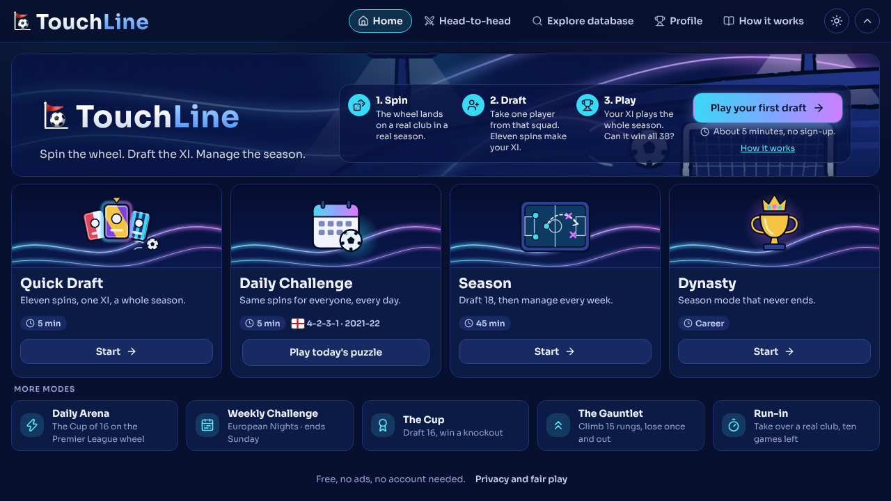
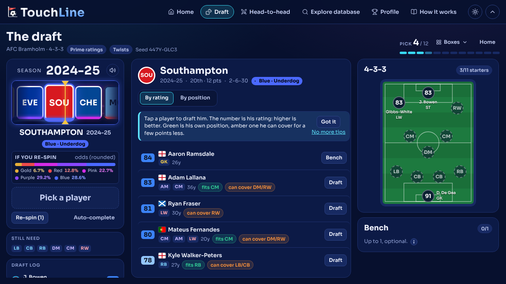
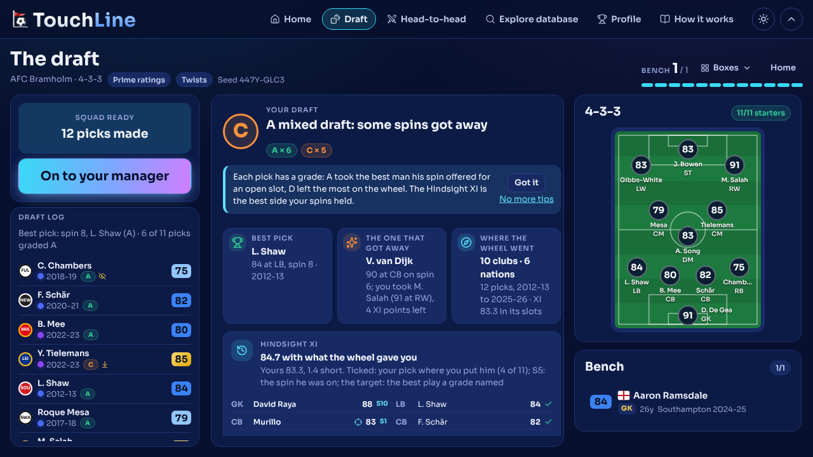
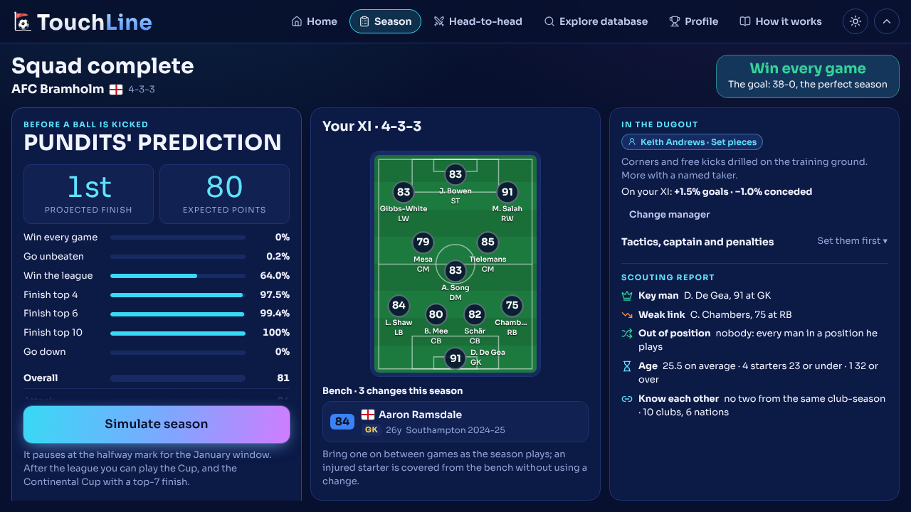
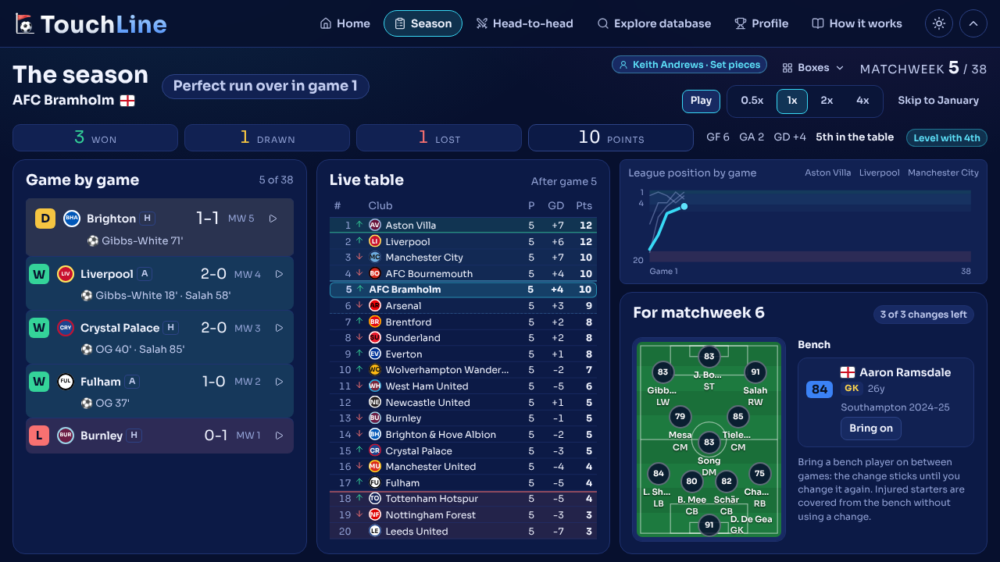
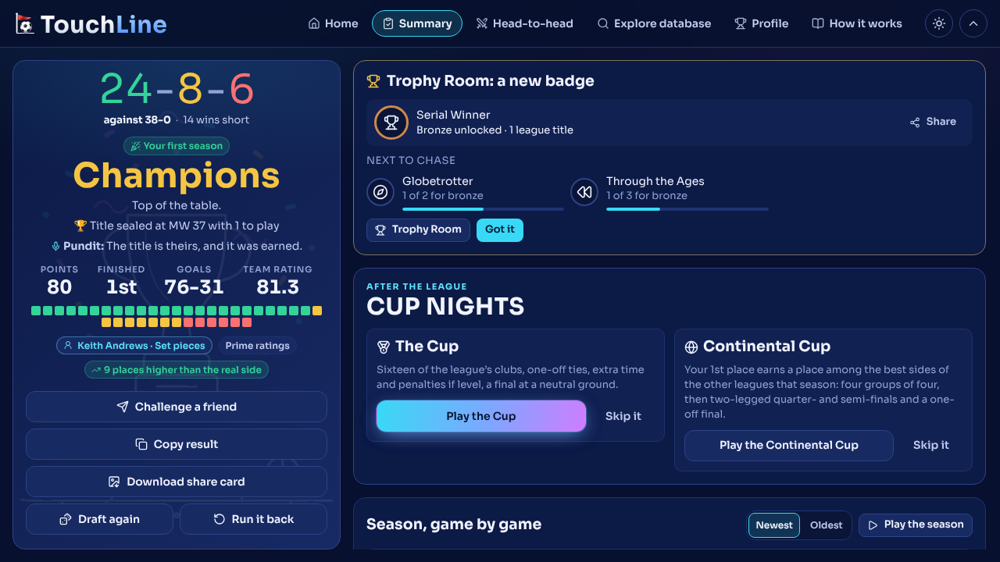
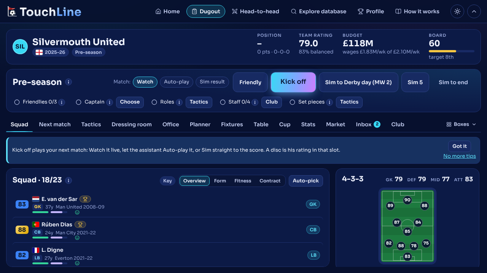
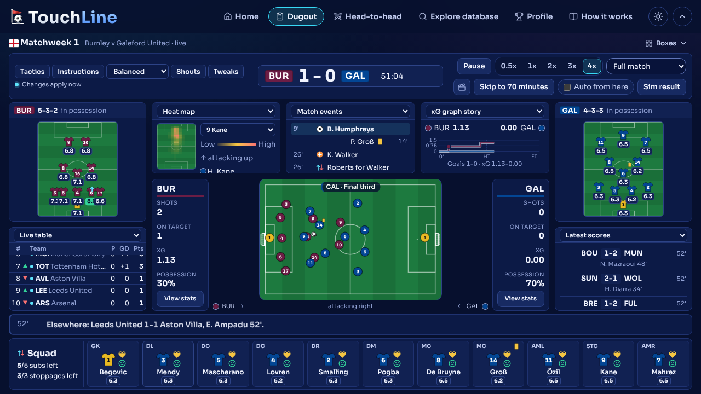

# TouchLine

**Spin the wheel. Draft the XI. Manage the season.**

TouchLine is a free browser football game. It takes the spin-and-draft loop of 38-0 and adds the week-by-week management of Football Manager. A wheel lands on a real club in a real season, and you draft one player from that squad. Repeat until your side is built. Then simulate the season in a few minutes, or manage it one matchweek at a time.

Your drafted side takes one real club's place in a real league season and plays the other clubs' real squads. Can you go 38-0?

## Play

**Play at [https://touchline.quest](https://touchline.quest).** It runs in any modern browser on a desktop, tablet or phone.

- No account and no ads. Your games save in the browser, and every mode works signed out and offline once the site has loaded (it installs as an app).
- An optional account adds cloud saves, the world leaderboards (the Daily, the weekly challenge, the 38-0 chase, the Daily Arena, the Weekly Challenge and the Run-in of the week, every run replayed by the server) and online head-to-head rooms. The in-game **Privacy and fair play** page says what is stored, where, for how long and how to delete it.
- **How it works**, on the top bar, explains every mode and rule in the game.

## Screenshots

| Home | The draft |
| --- | --- |
|  |  |

| The draft recap | Squad complete |
| --- | --- |
|  |  |

| The season, game by game | The summary |
| --- | --- |
|  |  |

| The Dugout | Match day |
| --- | --- |
|  |  |

## What's in the game

**The data.** Seven leagues: the Premier League, La Liga, Serie A, the Bundesliga, Ligue 1, the Eredivisie and the Primeira Liga. They cover 19 seasons, from 2008-09 to 2026-27: 69,155 player-seasons in 2,526 club-seasons. There are also the Premier League's 16 classic seasons, from 1992-93 to 2007-08 (8,903 player-seasons with estimated ratings). Classic seasons are opt-in and always labelled as estimated.

**Modes**

- **Quick Draft**: eleven spins, an XI and an optional bench. You get the pundits' prediction, then a manager from three spinning reels. Watch the season game by game beside a live table, with a January window and three bench changes. The Cup and the Continental Cup (groups, then two-legged ties) follow, and the league with both cups is the Treble. Setup adds Modes such as Crazy, Underdog, Legends, Speedrun, Gamble and the Upgrader, along with power-ups, the Moneyball salary cap, the Teammate Chain, the Super League (the nineteen greatest sides in the data) and an end-of-draft case.
- **Daily Challenge**: the same wheel for everyone each day (UTC), from one of the seven leagues in turn (from 2026-10-30), with streaks and a verified world board.
- **Weekly Challenge**: a themed wheel each week, such as European Nights, Moneyball or Park the bus, with its own world board.
- **Daily Arena**: one arena puzzle a day for everyone, the Gauntlet and the Cup in turn, with its own world board.
- **Season**: draft 16 to 22 players, then manage every matchweek. You have live matches, roles and instructions, condition and morale, injuries and suspensions, a cup and the Continental Cup, a transfer market with fee and personal-terms negotiations, scouting and contract talks, players who want out, promises and conversations in the Office, and a board that can sack you.
- **Dynasty**: Season mode that never ends. Players age and retire, contracts run out unless you renew them, a youth intake arrives, and every summer brings a draft and a transfer window.
- **Arena: The Cup and The Gauntlet**: draft a squad, then win a knockout of 8, 16 or 32 real club-seasons. Or climb fifteen rungs of ever stronger sides until your first defeat.
- **Run-in**: take over a real club at matchweek 28 with its real squad and a brief (the title, the top four, survival). You get four spins to strengthen it, then the last games. The Run-in of the week is one job for everyone, ranked online.
- **Head-to-head**: two managers draft from the same spins and play the same season, on one device or in an online room with a link (guests welcome).

**Around them**

- A deterministic seeded engine. One seed replays the same way on every device, which is what makes the Daily, challenge links and the ranked boards fair. The server replays every ranked run.
- An xG match engine with live stops at half time and the 70th minute. Changes can come at any minute, on a substitution board.
- A live match on a 2D pitch after Football Manager's view, with a commentary banner, heat maps, an xG story and goal replays.
- Ghost-draft challenge links, a share card for every result with a "beat me" box, a Trophy Room with badges, milestones and an honours board, and record books against the real seasons.
- Explore: every club-season's real squad, the best player-seasons by position, records from the data, and a Football Manager style profile for any player (attributes, career, best seasons, roles, similar players).
- Light and dark themes, a phone layout with the menu in thumb reach, a synthesised sound palette (no audio files), and keyboard and screen-reader support ([ACCESSIBILITY.md](docs/ACCESSIBILITY.md)).

The full list is in [docs/FEATURES.md](docs/FEATURES.md), and every system and formula is in [docs/GAME_DESIGN.md](docs/GAME_DESIGN.md).

## Run it locally

You need Node 22.13 or later (`package.json` engines; CI uses Node 22).

```bash
git clone https://github.com/Minhhh13/Touchline.git
cd Touchline
npm ci
npm run dev        # Vite dev server on http://localhost:5173
npm test           # Vitest: engine, draft, match, season, data and UI checks (a few minutes)
npm run typecheck  # tsc -b --noEmit
npm run build      # tsc -b && vite build, output in dist/
npm run preview    # serve the production build
```

The player database ships in the repository as generated league packs in `public/data/`, one folder per league (1.1 to 1.5 MB each), loaded on demand. The online layer stays off unless `VITE_SUPABASE_URL` and `VITE_SUPABASE_ANON_KEY` are set, so a plain checkout is the complete offline game.

To rebuild the data from the public datasets, run `node scripts/import/build.mjs`. It downloads several large archives on the first run and needs `unzip` and Node's `node:sqlite`. [docs/DATA.md](docs/DATA.md) covers the method, the cache location and the optional enrichment steps.

## How the code is organised

- `src/engine/`: the pure, deterministic engine (the RNG, wheel and draft, ratings, match engine, season, cups, market, the arena's knockouts). No React, no DOM.
- `src/game/`: the save format, the Zustand store and the game rules on top of the engine (`logic/`).
- `src/ui/`: the React screens and components, one stylesheet built on the tokens in [DESIGN_SYSTEM.md](docs/DESIGN_SYSTEM.md).
- `src/online/` and `supabase/`: the optional online layer. This holds the client, sync, boards and rooms, plus the server-side verifier, the Edge Function and the database migrations ([ONLINE.md](docs/ONLINE.md)).
- `scripts/import/`: the offline data pipeline.

The stack is Vite 6, React 19, TypeScript 5.8 (strict), Zustand 5 with Immer, Vitest 3 and Lucide icons. [CLAUDE.md](CLAUDE.md) maps every module in detail, and [docs/HANDOVER.md](docs/HANDOVER.md) records what is live, what is being built and how it is hosted.

## Data and credits

Ratings and squads come from public datasets:

- Stefano Leone's EA Sports FC 24 complete player dataset (CC0)
- nyagami's FC 25 database (Apache 2.0)
- justdhia's FC 26 ratings (CC0)
- mikedpad's FC 27 ratings (an unofficial non-commercial snapshot)
- Hugo Mathien's European Soccer Database (ODbL)
- openfootball results (public domain)
- Wikidata (CC0)

The classic seasons' squads, appearances and goals are facts taken from English Wikipedia club-season and player articles (CC BY-SA 4.0, no text reproduced) and from Wikidata. The classic-season ratings are TouchLine's own estimates. A player's rating for a season comes from the edition published after it, and values and wages are our own model. Sources, method, licences and known limits are in [docs/DATA.md](docs/DATA.md).

The pictures are our own drawings (`src/ui/components/Art.tsx`). Icons are [Lucide](https://lucide.dev) (ISC), flags are [flag-icons](https://github.com/lipis/flag-icons) (MIT) and the typeface is Sora (OFL). They are credited in [docs/CREDITS.md](docs/CREDITS.md).

## Contributing

TouchLine is built by two people, the owner and a friend, each working with an AI coding agent. The repository is public, so you are welcome to read it, play it and open an issue for a bug or an idea: https://github.com/Minhhh13/Touchline/issues.

Work follows [CONTRIBUTING.md](CONTRIBUTING.md): an issue first, one branch per change, a pull request into `main` with green CI, and [docs/HANDOVER.md](docs/HANDOVER.md) updated in the same pull request. AI agents start from [CLAUDE.md](CLAUDE.md). Please ask in an issue before starting a large pull request.

## Licence

All rights reserved until the owner chooses a licence. The code is public to read, but no licence to reuse it is granted yet. The datasets keep their own licences, listed above and in [docs/DATA.md](docs/DATA.md) and [docs/CREDITS.md](docs/CREDITS.md).

## Disclaimer

TouchLine is an independent fan project. It is not affiliated with, endorsed by or sponsored by any league, club, governing body, game publisher or ratings provider. Club and player names are used descriptively; no official crests, logos, kits or likenesses are used. Player ratings are an independent interpretation derived from publicly available data and may differ from any official source. Datasets are credited to their authors and used under their published licences.
